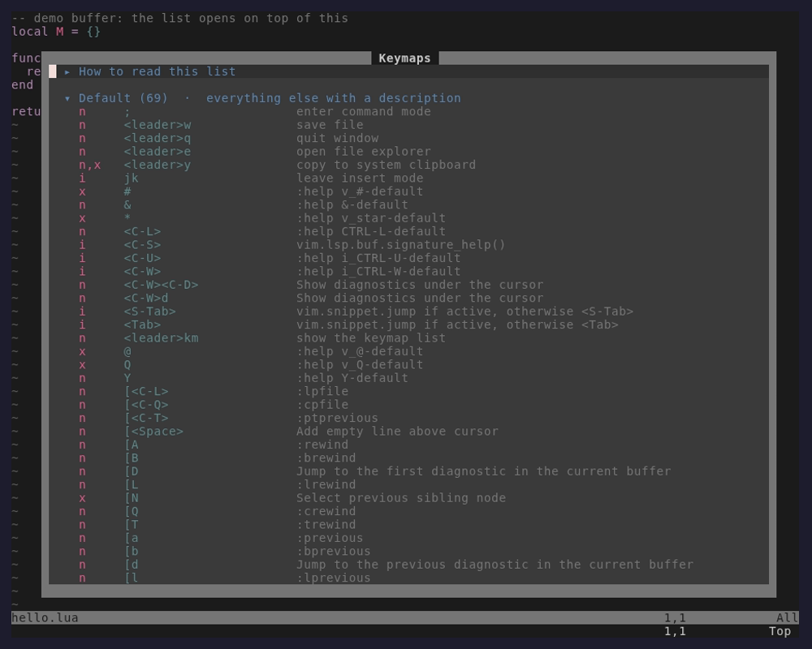
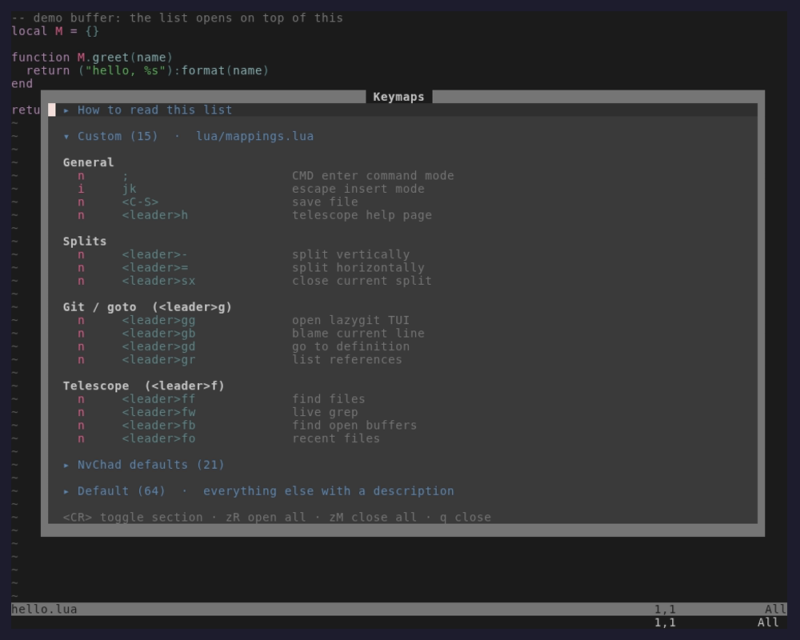
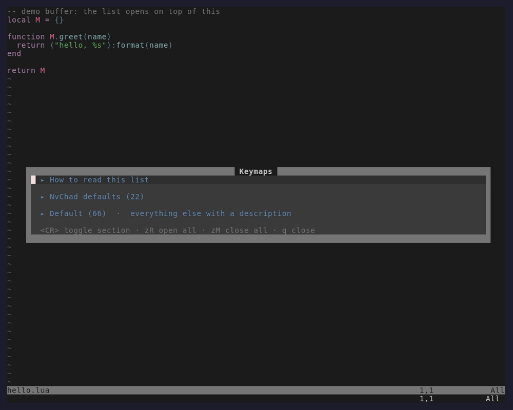
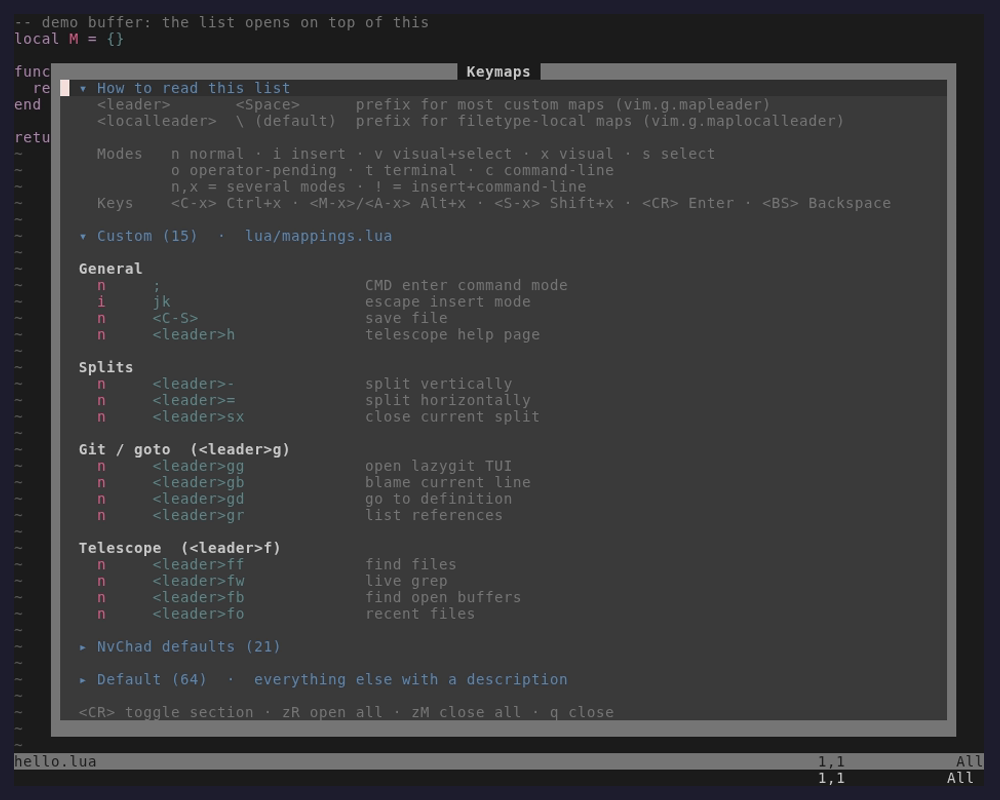
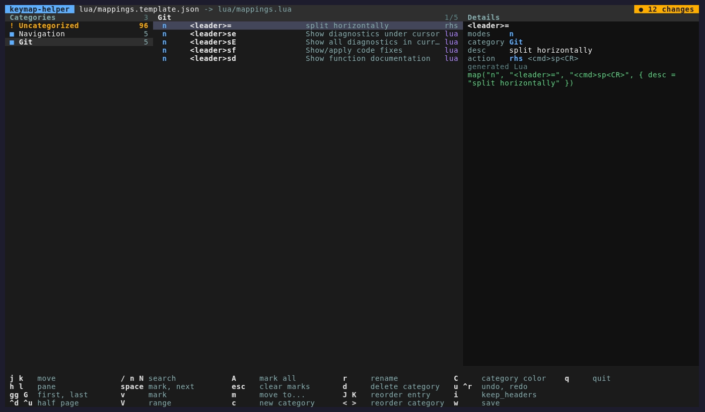
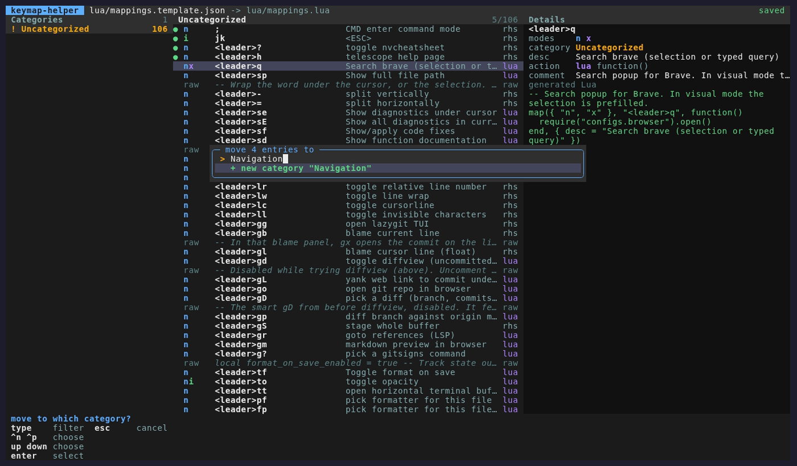
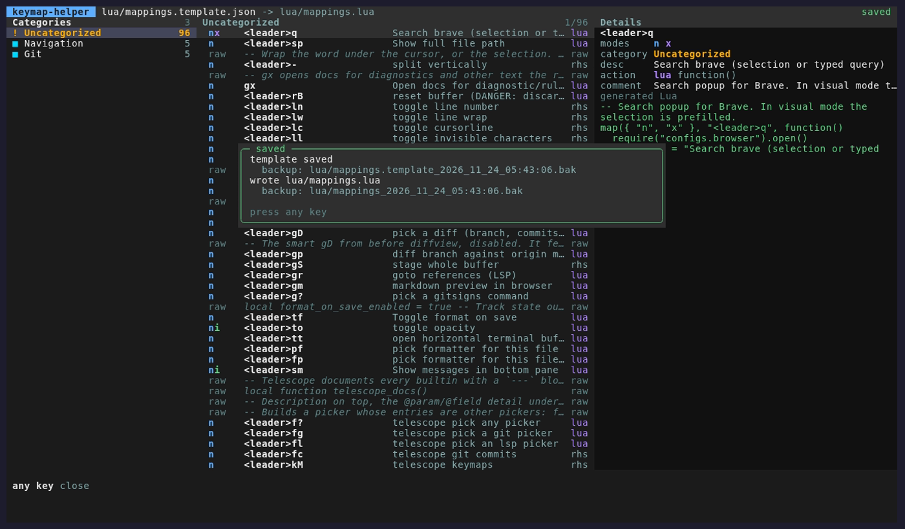

# keymap-helper.nvim

A grouped, collapsible list of your Neovim keymaps, opened with `<leader>km`. With no
configuration it lists every keymap that has a description. Add sections to split the list
by file, plugin, origin or pattern.



With a config like the NvChad example below, the list is split into your own groups and
NvChad's folded defaults:




On startup a small centered hint says which key opens the list. It closes on the first
keypress or after 6 seconds.

## Requirements

- Neovim >= 0.11
- [popup.nvim](https://github.com/hosua/popup.nvim) (the list and hint windows) and
  [plenary.nvim](https://github.com/nvim-lua/plenary.nvim), both listed as lazy.nvim
  `dependencies`
- Optional: [lazy.nvim](https://github.com/folke/lazy.nvim) (names the plugin behind lazy
  `keys` maps) and [which-key.nvim](https://github.com/folke/which-key.nvim) (names
  `<leader>x` groups when `group_by = "leader_prefix"`)

## Install

lazy.nvim. `VimEnter` loads it in time for the startup hint, and `cmd` covers the
command if you turn the hint off:

```lua
{
  "hosua/keymap-helper.nvim",
  dependencies = { "hosua/popup.nvim", "nvim-lua/plenary.nvim" },
  cmd = { "KeymapHelper" },
  event = "VimEnter",
  opts = {},
}
```

That is all: `<leader>km` opens the list. Set `mapleader` before the plugin loads. To use
another key set `keymap = "<leader>?"`, or `keymap = false` to map your own (use a
`"<cmd>KeymapHelper<cr>"` string rather than a Lua function, so the startup hint can show
your key). A key you already mapped is never overwritten.

## Example: an NvChad config

The author's `lua/plugins/keymap-helper.lua`: custom maps first, grouped by the box comments
in `lua/mappings.lua`, then NvChad's own maps, folded.

```lua
return {
  {
    "hosua/keymap-helper.nvim",
    cmd = { "KeymapHelper" },
    event = "VimEnter",
    opts = {
      sections = {
        { title = "Custom", subtitle = "lua/mappings.lua", files = { "lua/mappings.lua" }, group_by = "header" },
        { title = "NvChad defaults", runtime_files = { "lua/nvchad/mappings.lua" }, collapsed = true },
      },
    },
  },
}
```

Everything those two sections do not claim lands in a folded "Default" section at the end,
so it does not need to be listed.

### How headers become groups

`group_by = "header"` reads the comments in the section's files. Every line that matches
`header_pattern` (default: `-- │ Name │`) starts a group, and the maps below it belong to
that group. The box's top and bottom lines are decoration. Part of that `lua/mappings.lua`:

```lua
require "nvchad.mappings"

local map = vim.keymap.set

-- ┌──────────────────────────────────────────┐
-- │ General                                  │
-- └──────────────────────────────────────────┘

map("n", ";", ":", { desc = "CMD enter command mode" })
map("n", "<leader>h", "<cmd>Telescope help_tags<CR>", { desc = "telescope help page" })

-- ┌──────────────────────────────────────────┐
-- │ Splits                                   │
-- └──────────────────────────────────────────┘

map("n", "<leader>-", "<cmd>vsp<CR>", { desc = "split vertically" })
map("n", "<leader>=", "<cmd>sp<CR>", { desc = "split horizontally" })

-- ┌──────────────────────────────────────────┐
-- │ Git / goto  (<leader>g)                  │
-- └──────────────────────────────────────────┘

map("n", "<leader>gg", "<cmd>LazyGit<CR>", { desc = "open lazygit TUI" })
map("n", "<leader>gb", "<cmd>Gitsigns blame<CR>", { desc = "blame current line" })
```

This shows as a "Custom" section with the groups "General", "Splits" and
"Git / goto  (<leader>g)" (see the screenshot above). A map that NvChad sets and this file overrides shows once, under
Custom. A NvChad map deleted with `vim.keymap.del` is not shown at all.

### Only want NvChad's maps split out?

One section is enough. Everything else stays in "Default":

```lua
opts = {
  sections = {
    { title = "NvChad defaults", runtime_files = { "lua/nvchad/mappings.lua" }, collapsed = true },
  },
}
```

`runtime_files` is looked up on `'runtimepath'`, so this path works for a stock NvChad
install. If your maps live elsewhere (for example `lua/custom/mappings.lua` or several
files), list those paths in a `files` section instead. `:checkhealth keymap-helper` says
whether each file was found.



## The legend

The list opens with a "How to read this list" section that resolves your real `<leader>`
and explains mode letters and key notation. Rows are coloured by role: mode, key, description.



## Commands

| Command | What it does |
|---|---|
| `:KeymapHelper` / `:KeymapHelper show` | Open the keymap list |
| `:KeymapHelper hint` | Show the startup hint again |
| `:KeymapHelper health` | Same as `:checkhealth keymap-helper` |
| `:KeymapHelper import [keep_headers]` | Build the keymap template from your mappings file (see below) |
| `:KeymapHelper generate [check]` | Write the mappings file from the template, or with `check` only say whether it is in sync |

`import!` and `generate!` skip the yes/no question. `:KeymapHelper` completes the
subcommands and their words.

## Keep your keymaps in a template

The template is a JSON file next to your mappings file. It becomes the source of truth:
you change keymaps in the JSON and `generate` writes `lua/mappings.lua` from it. The
generated file starts with a five-line `AUTOGENERATED` header saying not to edit it.

Import is the first step. It reads your current `lua/mappings.lua` with the treesitter Lua
parser:

```vim
:KeymapHelper import
:KeymapHelper generate
```

- Every top-level `map(...)` or `vim.keymap.set(...)` call whose modes and lhs are string
  literals becomes an entry. A string rhs is stored as `rhs`. A function or any other
  expression is stored as `lua`, the source text, written back unchanged.
- Everything else stays as a `raw` block at its original position: the `require` line,
  local helpers, `for` loops that create maps, `vim.keymap.del` calls, a map whose lhs is
  built from a variable. Nothing is dropped. A raw block that creates maps (a loop) is
  not expanded into entries, so those maps are not listed in the template as entries.
- A comment directly above a map (no blank line) is kept as the entry's `comment`, one on
  the same line after it as `trailing`.
- Every imported map goes in the `Uncategorized` category. Your box-comment headers are
  dropped, so you can sort the maps yourself. `:KeymapHelper import keep_headers` (or
  `kh-import --keep-headers`) turns the headers into categories instead.
- When the template already exists and generates your current mappings file, import says
  so and changes nothing. When the file has drifted from the template, import asks before
  replacing the template (the old one is saved first).

`generate` checks the template first and writes nothing when it is invalid. If the target
exists it is copied to `mappings_<YYYY_MM_DD_hh:mm:ss>.bak` next to it before the new file
replaces it (write to a temp file, then rename). A backup is never overwritten: two in the
same second get `_1`, `_2`. Running `generate` twice changes nothing the second time, and
makes no second backup. To undo, copy the newest backup over `lua/mappings.lua`. A target
that was not generated by keymap-helper (no header) needs a yes first. Add the backups to
`.gitignore`:

```gitignore
mappings_*.bak
mappings.template_*.bak
```

The categories become the box-comment headers `group_by = "header"` reads, so a section
like `{ title = "Custom", files = { "lua/mappings.lua" }, group_by = "header" }` shows them
as groups.

### Scripts

Both run under `nvim -l`, so they use the same code as the commands:

```bash
scripts/kh-import   --root=$HOME/.config/nvim [--keep-headers] [--yes]
scripts/kh-generate --root=$HOME/.config/nvim [--check] [--yes]
```

`kh-generate --check` writes nothing and exits 1 when the file on disk differs from what
the template generates, so a hook can use it. Both scripts need
[plenary.nvim](https://github.com/nvim-lua/plenary.nvim): they look in `$PLENARY_DIR`, the
lazy.nvim data dir and the directory next to the plugin. Without a terminal and without
`--yes`, a step that needs a yes stops with exit code 2. Run `--help` for every flag and the
shell completion install lines.

### Template format

```json
{
  "version": 1,
  "target": "lua/mappings.lua",
  "preamble": ["require \"nvchad.mappings\"", "local map = vim.keymap.set"],
  "categories": [
    { "id": "uncategorized", "title": "Uncategorized" },
    { "id": "general", "title": "General", "subtitle": "optional note under the header" }
  ],
  "entries": [
    {
      "id": "e001",
      "kind": "map",
      "category": "general",
      "modes": ["n", "x"],
      "lhs": "<leader>q",
      "lua": ["function()", "  require(\"configs.browser\").open()", "end"],
      "opts": { "desc": "Search brave", "silent": true },
      "opts_raw": { "callback_hint": "vim.g.x or 1" },
      "comment": "-- text written above the call",
      "trailing": "-- text after it",
      "call": "vim.keymap.set"
    },
    { "id": "e002", "kind": "raw", "category": "general", "text": "local seen = {}" }
  ]
}
```

- Entries are written in array order. A box header is written whenever the category changes
  from one entry to the next. The preamble comes before all entries.
- A `map` entry has `rhs` (a string) or `lua` (Lua source), never both.
- `lua`, `comment`, `trailing`, `text` and the preamble items are strings, or lists of
  lines joined with newlines (how the file stores multi-line code).
- `opts` holds the typed options: `desc` (string), `silent`, `expr`, `remap`, `noremap`,
  `nowait`, `unique`, `script`, `replace_keycodes` (booleans) and `buffer` (boolean or
  number). Any other option, or one whose value is not a literal, goes in `opts_raw` as
  Lua source text.
- `call` is the function name written (default `map`, which needs `local map =
  vim.keymap.set` in the preamble).
- The category `uncategorized` must exist. Ids are unique. A key starting with `_` on an
  entry is ignored by the generator and kept, for other tools.
- The box header is 80 columns wide, the width of the headers the plugin already read.
  A category title is at most 70 columns.

## Sort keymaps in the terminal UI

`tui/` holds a terminal UI (Bun and [OpenTUI](https://opentui.com)) for putting the entries of
your template into categories. It needs [bun](https://bun.sh) 1.3.14 or later, `nvim`, and
plenary.nvim where the scripts can find it (see Scripts above). Install its packages once:

```bash
(cd tui && bun install --frozen-lockfile)
bun run tui/src/index.tsx --root $HOME/.config/nvim [--template FILE] [--target FILE]
tui/bin/keymap-helper-tui --root $HOME/.config/nvim     # same thing, bun shebang
```

The UI never edits a Lua file. It reads and writes the template through
`scripts/kh-template` and generates `lua/mappings.lua` with `scripts/kh-generate`, so the
backup, validation and generation rules exist once, in Lua. With no template yet it offers
to import your mappings file first: `y` imports everything as Uncategorized, `h` keeps the
file's box headers as categories.

<div align="center" markdown="1">



*Categories, entries and the exact Lua line of the selected map*

</div>

The left pane lists the categories with their entry counts. Uncategorized is always first,
yellow and bold while it still holds entries. The middle pane lists the entries of the
selected category: a colored badge per mode, the lhs, the description (or the rhs), and
`rhs`, `lua` or `raw`. The right pane shows the options, the comment and the Lua line the
generator will write for that entry. Raw blocks (a `require`, a helper, a loop) are shown
dimmed. They can be moved but not edited, and moving one changes when it runs.

### Keys

| Key | Action |
|---|---|
| `j` `k`, `h` `l`, `gg` `G`, `<C-d>` `<C-u>` | Move, switch pane (`h` categories, `l` entries), first and last, half page |
| `/`, `n` `N` | Search the focused pane, next and previous match |
| `<Space>` | Mark the entry and move down |
| `v` | Mark the entry |
| `V` | Start a range from here; `V` again turns the range into marks |
| `A`, `<Esc>` | Mark every entry of the category, clear the marks and any range |
| `m` | In the entries pane: move the marked entries (or the one under the cursor) to a category you pick with a fuzzy filter, or to a new one |
| `c`, `r`, `d` | New category, rename, delete (its entries return to Uncategorized, after a confirm) |
| `J` `K` | In the entries pane: move the marked entries (or the current one) down and up inside the category |
| `<` `>` | Move the selected category up and down |
| `C` | Next color for the selected category (this session only) |
| `u`, `<C-r>` | Undo, redo (in memory) |
| `i` | Preview what `kh-import --keep-headers` would build; `<CR>` applies it after a confirm, `i` leaves |
| `w` | Save |
| `q`, `<C-c>` | Quit; with unsaved changes it asks |

Marks stay when you change category, so one `m` can move entries from several categories.
In the move picker, type to filter, `<C-n>` `<C-p>` or the arrows to choose, `<CR>` to
pick, `<Esc>` to cancel. The last item is `+ new category`: with text typed it creates a
category with that name, without text it asks for one. The mouse works too: click a row,
scroll with the wheel.

<div align="center" markdown="1">



*Move the marked entries to a category*

</div>

### Saving

`w` shows what will change (entries moved, categories added, renamed or deleted, entries
reordered) and asks. After `y` it does two things:

1. Writes the template through `kh-template save`. The old template is copied to
   `mappings.template_<YYYY_MM_DD_hh:mm:ss>.bak` next to it.
2. Runs `kh-generate`, which copies the old mappings file to
   `mappings_<YYYY_MM_DD_hh:mm:ss>.bak` and writes the new one.

<div align="center" markdown="1">



*After a save, both backups are listed*

</div>

If the template is saved but generating fails, the result says so and names the error. The
template is already on disk, so fix the error and run `scripts/kh-generate`. Entries you
do not touch keep their fields and their place within their category. The generator writes
entries grouped by category, in the order of the left pane, and a category the template
holds in several runs is grouped into one block when the UI loads it (it says so, and
nothing is written until you save).

The keep_headers preview is read only. It shows the template an import would build from
your current mappings file. Applying it replaces your template (backed up first) and drops
the unsaved edits of the session.

Entries may carry keys that start with `_`, which the schema keeps and the generator
ignores. The details pane shows a list of strings in `_badges` as chips, so another tool
can flag an entry without the UI knowing about it.

## Keys inside the list

| Key | Action |
|---|---|
| `<CR>`, `za`, `<Tab>` | Toggle the section under the cursor |
| `l` / `h` | Open / close the section under the cursor |
| `zR` / `zM` | Open / close every section (the intro too) |
| Left click on a section header | Toggle it (any other click works as normal) |
| `q`, `<Esc>` | Close |

## How maps are sorted into sections

Each map goes to the **first** section whose matchers all pass. Sections with `rest = true` are
tried last. A map's origin is worked out from, in order:

1. `track()`, if you turned it on (see below): the exact file that called `vim.keymap.set`.
2. lazy.nvim `keys` specs: the plugin that declared the key.
3. The file a Lua callback was defined in (`map("n", "x", function() ... end)`).
4. Neovim's script id, but only when it carries a line number. During normal startup every
   Lua-set map reports `init.lua` with line 0, which says nothing about the real file.
5. A text scan of your config's `*.lua` files for `map(...)` / `vim.keymap.set(...)` calls.
   This is how string-rhs maps such as `"<cmd>w<cr>"` get placed.
6. Neovim's own defaults (`:help Y-default` style descriptions, `$VIMRUNTIME` files).

Rows always come from what is **live** right now, so a map you deleted with `vim.keymap.del`
is not listed, even when it is still in some plugin's mappings file. Maps with no `desc` and
`<Plug>` maps are hidden (set `show_undocumented = true`), except maps that a `files` section
claims: those show even without a description.

String-rhs maps set by plugins have no recorded origin, so they land in the "Default" (rest)
section unless you use `track()` or give that plugin a `runtime_files` section.

## Configuration

Every option, with its default:

<!-- defaults:start -->
```lua
require("keymap-helper").setup {
  sections = {
    { title = "Default", subtitle = "everything else with a description", rest = true, collapsed = false },
  },
  -- Normal-mode key that opens the list, or false for none. A key you already
  -- mapped is never overwritten.
  keymap = "<leader>km",
  -- Show maps with no desc and <Plug> maps (file sections always show their own).
  show_undocumented = false,
  detect = {
    scan_config = true, -- text-scan stdpath("config") *.lua to place string-rhs maps
    max_files = 200, -- stop scanning after this many files (health warns)
    lazy_keys = true, -- read lazy.nvim `keys` specs for plugin names
    which_key = true, -- name <leader>x groups after which-key groups, if loaded
  },
  -- Lua pattern for a section header comment; capture 1 is the header text.
  -- The default matches `-- │ General │` box-drawing headers.
  header_pattern = "^%-%- │%s*(.-)%s*│$",
  -- Function names treated as "set a mapping" when scanning files.
  map_functions = { "map", "vim.keymap.set", "keymap.set" },
  -- Modes whose live mappings are listed (plus any mode a `files` section sets).
  modes = { "n", "i", "v", "x", "t" },
  window = {
    title = " Keymaps ",
    max_width = 96,
  },
  hint = {
    enabled = true,
    -- `{key}` becomes the key you mapped to :KeymapHelper, or the command itself.
    message = "Type {key} to view a list of all keymappings!",
    timeout_ms = 6000,
    -- "center" or "bottom_right".
    position = "center",
  },
  -- Short "how to read this list" header (leader keys, mode letters).
  intro = { enabled = true, collapsed = false },
  -- The keymap template: a JSON file that is the source of truth, and the Lua
  -- file :KeymapHelper generate writes from it. Relative paths resolve against
  -- stdpath("config"). `backups = false` skips the .bak copy before an overwrite.
  template = { path = "lua/mappings.template.json", target = "lua/mappings.lua", backups = true },
}
```
<!-- defaults:end -->

`sections`, `modes` and `map_functions` replace the defaults outright; every other table
merges key by key. Unknown keys (including misspelled section keys such as `colapsed`) are
reported with a warning.

### Section keys

| Key | Type | Meaning |
|---|---|---|
| `title` | string, required | Section header |
| `subtitle` | string | Dimmed text after the title |
| `config` | boolean | Maps set by your config (`stdpath("config")`) |
| `builtin` | boolean | Maps set by Neovim itself |
| `plugin` | `true`, name, or list of names | Maps set by any plugin, or the named ones (case-insensitive, `.nvim` optional) |
| `files` | string[] | Maps set in these files (relative paths resolve against `stdpath("config")`). Supplies header groups and file order |
| `runtime_files` | string[] | Like `files`, looked up on `'runtimepath'`, e.g. `"lua/nvchad/mappings.lua"` |
| `lhs` / `desc` | Lua pattern | Match the displayed lhs (`<leader>gb`) / the desc |
| `mode` | string or string[] | Only these modes |
| `fn` | `function(map, origin) -> boolean` | Custom matcher. `origin.kind` is `config`, `plugin`, `builtin` or `unknown`; `origin.plugin`, `origin.file` when known |
| `rest` | boolean | Fallback: takes whatever no other section matched |
| `group_by` | `"header"`, `"plugin"`, `"leader_prefix"`, `"none"` | Sub-groups. `header` uses `-- │ Name │` comments in the files, `leader_prefix` groups by `<leader>x` |
| `collapsed` | boolean | Start folded |
| `hidden` | boolean | Claim the maps but do not show the section (to suppress noise) |

All matcher keys in one section must pass. If no section has `rest = true`, unmatched maps
go to a folded "Default" section added at the end, which only appears when it has rows. To
drop them instead, add `{ title = "rest", rest = true, hidden = true }`.

### Recipes

Split by origin (your config, each plugin, Neovim itself):

```lua
opts = {
  sections = {
    { title = "Your config", config = true, group_by = "header" },
    { title = "Plugins", plugin = true, group_by = "plugin", collapsed = true },
    { title = "Neovim defaults", builtin = true, collapsed = true },
    { title = "Other", subtitle = "origin unknown", rest = true, collapsed = true },
  },
}
```

LazyVim: add this to your sections:

```lua
{ title = "LazyVim", runtime_files = { "lua/lazyvim/config/keymaps.lua" }, group_by = "leader_prefix", collapsed = true },
```

Filters:

```lua
{ title = "Git", lhs = "^<leader>g" },
{ title = "Terminal", mode = "t" },
{ title = "Mine", fn = function(map, origin) return origin.kind == "config" end },
{ title = "noise", plugin = "some-plugin", hidden = true },
```

### `track()`: exact origins for every map

Optional. It wraps `vim.keymap.set` so each map records the file that set it, which places
string-rhs maps from plugins correctly too. It must run **before** anything sets maps, so put
it at the very top of `init.lua`, before lazy.nvim loads. The plugin is not on the
runtimepath yet at that point, so add it by hand:

```lua
local kh = vim.fn.stdpath "data" .. "/lazy/keymap-helper.nvim"
if vim.uv.fs_stat(kh) then
  vim.opt.rtp:prepend(kh)
  require("keymap-helper").track()
end
```

`:checkhealth keymap-helper` then shows `track() active: N maps recorded`. To undo it,
delete the block. Maps set through `vim.api.nvim_set_keymap`, or before `track()` runs,
fall back to the other detection layers.

## Highlight groups

All are linked with `default = true`, so your theme or `nvim_set_hl` overrides them.

| Group | Default link |
|---|---|
| `KeymapHelperSection` | `Type` |
| `KeymapHelperGroup` | `Title` |
| `KeymapHelperMode` | `Constant` |
| `KeymapHelperKey` | `Special` |
| `KeymapHelperDesc` | `Comment` |
| `KeymapHelperIntro` | `Comment` |
| `KeymapHelperFooter` | `Comment` |
| `KeymapHelperHintBorder` | `DiagnosticInfo` |

## Data on disk

The list and the hint write nothing: they read your config files and Neovim's live
keymaps. The template commands write only in your config, next to your mappings file:
the template JSON (`template.path`), the generated file (`template.target`), and the
`mappings_<YYYY_MM_DD_hh:mm:ss>.bak` and `mappings.template_<YYYY_MM_DD_hh:mm:ss>.bak`
backups they leave before overwriting.

## Troubleshooting

`:checkhealth keymap-helper` shows which copy of the plugin is loaded, whether each section's
`files` were found, how many maps each detection layer explained, and the first maps with no
known origin.

- **A plugin's maps are under "Default"**: they are string-rhs maps with no recorded origin.
  Use `track()` or add `{ title = "...", runtime_files = { "lua/<plugin>/mappings.lua" } }`.
- **`<leader>km` does nothing**: `:checkhealth keymap-helper` shows the key in use. The
  plugin does not overwrite a key you mapped yourself, and with lazy.nvim the key exists only
  once the plugin has loaded (`event = "VimEnter"`).
- **My maps show no groups**: `group_by = "header"` needs comments matching `header_pattern`
  (default `-- │ Name │`). Without them, use `group_by = "leader_prefix"`.
- **Maps set in an `LspAttach` autocmd are missing**: they are buffer-local, and the list only
  shows global maps.

## Development

```bash
make test         # headless unit tests, no dependencies, throwaway XDG tree
make integration  # end-to-end: detection against a fake config, and import -> generate on a copy of a real mappings file
make smoke        # real TUI in a private tmux server: hint, list, folding, mouse
make check        # stylua --check
make tui-test     # terminal UI: bun test (state, frames at 80x24 and 140x40, import -> save -> generate), tsc, biome
```

`make test` also runs `make tui-test`. Without bun it prints why it skipped and passes.
`make smoke` includes `tests/smoke/tui_smoke.sh`, which drives the UI in tmux against a
throwaway root and checks the generated file and both backups.

## License

MIT
